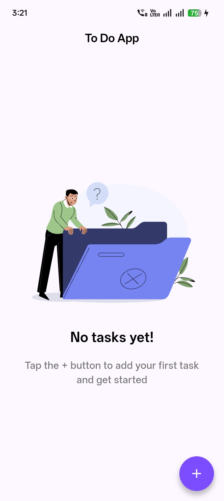
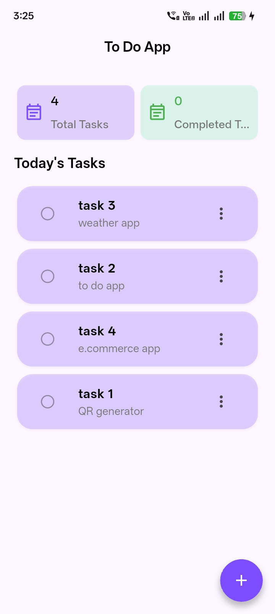
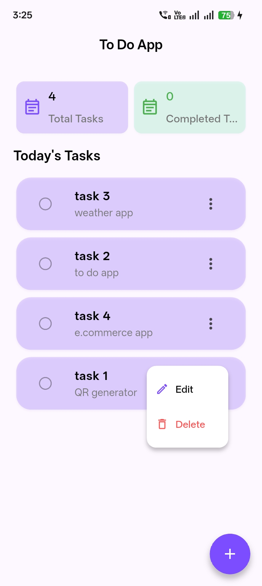
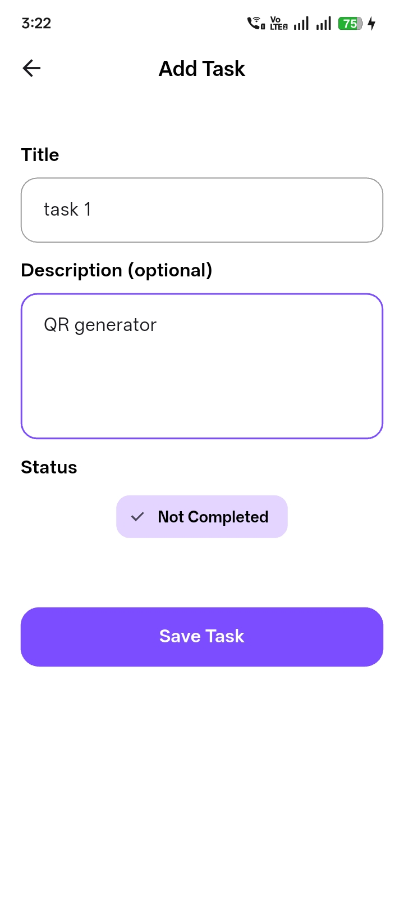
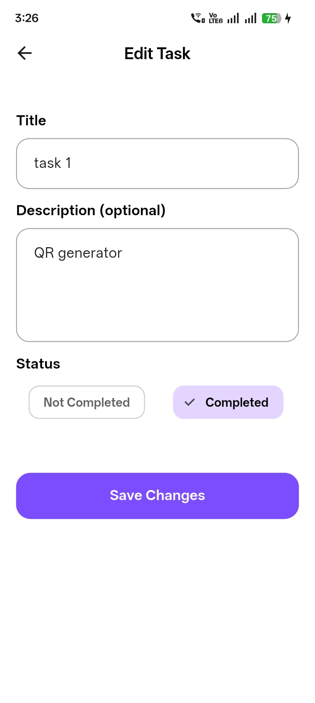
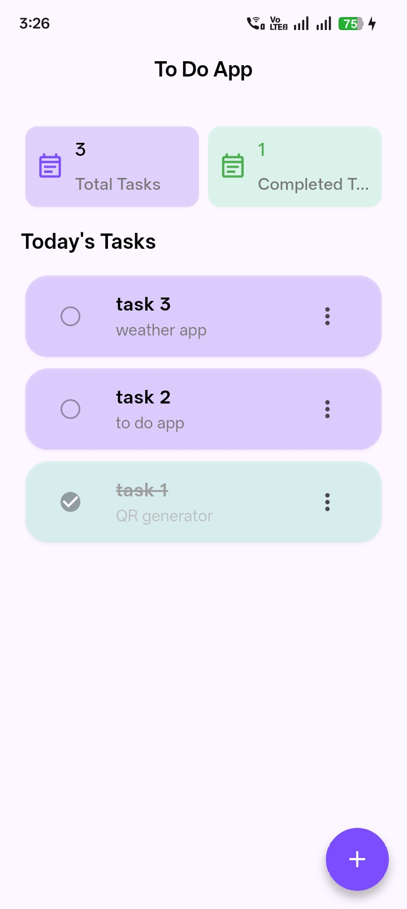
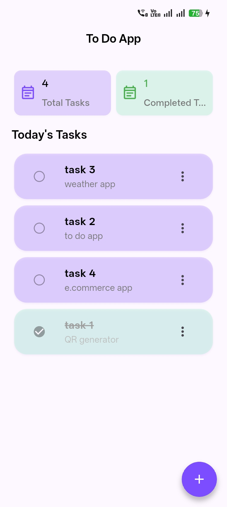
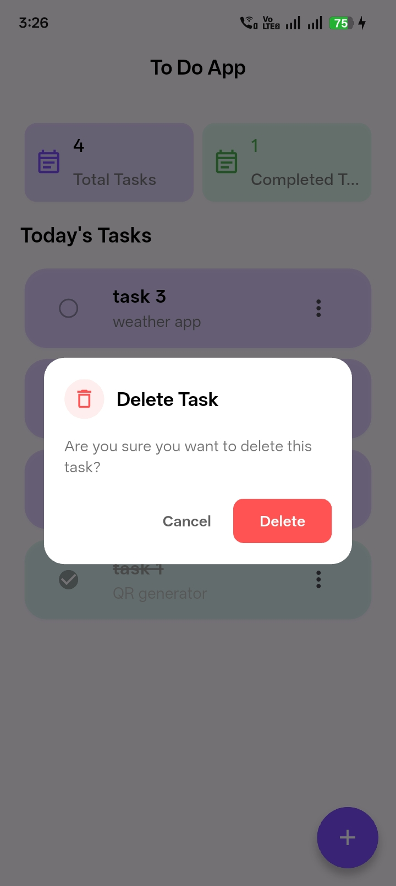

# To-Do App 📝

A Flutter task management application that helps users organize their daily tasks, track their progress, and manage completed and pending tasks.

The app provides a simple and user-friendly interface with local data persistence, allowing tasks to remain saved even after closing the application.

## 🚀 Features

- Add new tasks with titles and descriptions.
- Edit existing tasks.
- Delete tasks with confirmation.
- Mark tasks as completed or pending.
- View total and completed task counts.
- Display an empty state when there are no tasks.
- Persist tasks locally using Hive.
- Input validation to prevent invalid tasks.
- Responsive UI design.

## 🛠️ Technologies & Packages

- **Flutter & Dart** – Application development.
- **BLoC / Cubit** – State management.
- **Clean Architecture** – Maintainable and scalable code structure.
- **Hive** – Local database and data persistence.
- **GetIt** – Dependency injection.
- **UUID** – Unique task identifiers.
- **flutter_screenutil** – Responsive UI design.

## 🏗️ Project Architecture

The project follows Clean Architecture and is organized into three main layers:

- **Data Layer:** Hive data source, models, and repository implementation.
- **Domain Layer:** Entities, repository contracts, and use cases.
- **Presentation Layer:** UI screens, widgets, Cubit, and states.

## 💾 Local Data Storage

The application uses Hive as a local database to store tasks on the device.

Each task contains:
- Unique ID.
- Title.
- Description.
- Completion status.

Task data remains available between application sessions.

## ⚙️ Getting Started

To run this project locally:

1. Clone the repository:

   ```bash
   git clone https://github.com/mustafamahmoud8/to_do_app.git
   ```

2. Navigate to the project directory:

   ```bash
   cd to_do_app
   ```

3. Install dependencies:

   ```bash
   flutter pub get
   ```

4. Run the application:

   ```bash
   flutter run
   ```

## 📸 Screenshots

### Empty Tasks Screen


### Tasks List


### Task Actions


### Add Task


### Edit Task


### Completed Tasks


### Completed Task


### Delete Confirmation


## 👨‍💻 Developer

**Mustafa Mahmoud**

Flutter Developer

[GitHub](https://github.com/mustafamahmoud8)
[Portfolio](https://mustafa-mahmoud.vercel.app/)
